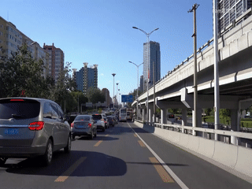
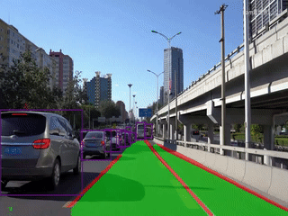
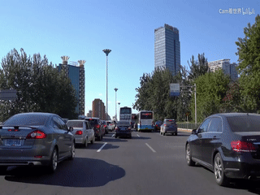
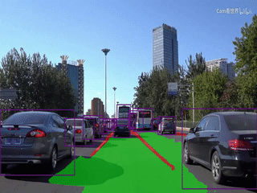

# YOLOP v1 on phyBOARD-Pollux  (i.MX8M Plus NPU)

Real-time **panoptic driving perception** — traffic object detection, drivable-area segmentation and
lane-line detection in a single network — running on the **phyBOARD-Pollux** with the on-board
**NPU** (TFLite + VX delegate), using an INT8-quantized YOLOP model at 320×320.

---

## Table of contents

1. [What is YOLOP?](#what-is-yolop)
2. [Results demonstration](#results-demonstration)
3. [Target platform](#target-platform)
4. [Project layout](#project-layout)
5. [Setup](#setup)
6. [Usage](#usage)
7. [How the pipeline works](#how-the-pipeline-works)
8. [YOLOP reference results](#yolop-reference-results-from-the-original-repo)
9. [Citation](#citation)
10. [Acknowledgements](#acknowledgements)

---

## What is YOLOP?

**YOLOP** (*You Only Look Once for Panoptic Driving Perception*) is a multi-task network for
autonomous-driving perception from Huazhong University of Science and Technology (HUST). It
efficiently and jointly handles three crucial tasks with one shared encoder:

| Task | Output |
|---|---|
| Traffic object detection | Bounding boxes (vehicles) |
| Drivable area segmentation | Pixel mask of the road area the car can drive on |
| Lane detection | Pixel mask of lane lines |

Key points from the original work:

- One network, one forward pass — a shared backbone/encoder feeds three task-specific decoder heads
  (a grid-based detection head and two segmentation heads).
- It was the first work to reach **real-time speed on embedded devices** (Jetson TX2 with TensorRT)
  while maintaining state-of-the-art accuracy on the challenging **BDD100K** dataset.
- It can be trained end-to-end, without alternating optimization between tasks.
- Sharing computation across tasks saves time and memory compared with running three separate
  models — which is exactly what matters on a small embedded board.

Original repository: <https://github.com/hustvl/YOLOP> · Paper: *Machine Intelligence Research* (2022).

---

## Results demonstration

Two driving clips were run through the model on the board. Each row below pairs the unprocessed
input with the YOLOP output.

### Demo 1

| Input | Output (YOLOP on phyBOARD-Pollux) |
|:---:|:---:|
|  |  |
|  |  |

> Left: raw road video. Right: YOLOP result — vehicle bounding boxes, drivable area and lane lines overlaid.

What to look for in the output:

- **Bounding boxes** around detected vehicles.
- **Drivable area** highlighted as a colored road mask.
- **Lane lines** highlighted as a separate colored mask.

---

## Target platform

| Item | Value |
|---|---|
| Board | phyBOARD-Pollux (NXP i.MX8M Plus) |
| Memory | 1.89 GB RAM |
| Accelerator | On-board NPU, used through the TFLite VX delegate (`/usr/lib/libvx_delegate.so`) |
| OS image | PHYTEC **BSP-Yocto-CelebrityFaceMatch-i.MX8MP-v0.7** |
| Model | YOLOP, 320×320, INT8-quantized TFLite (`model/yolop_320x320_intio.tflite`) |
| Runtime | `tflite-runtime` (or `ai-edge-litert`) + NumPy + OpenCV — no TensorFlow / PyTorch needed |

The board runs the PHYTEC release image
[BSP-Yocto-CelebrityFaceMatch-i.MX8MP-v0.7](https://download.phytec.de/Software/Linux/BSP-Yocto-CelebrityFaceMatch/BSP-Yocto-CelebrityFaceMatch-i.MX8MP-v0.7/)
(see its [ReleaseNotes](https://download.phytec.de/Software/Linux/BSP-Yocto-CelebrityFaceMatch/BSP-Yocto-CelebrityFaceMatch-i.MX8MP-v0.7/ReleaseNotes)
for the image contents, flashing instructions and known issues).

---

## Project layout

```
YoloP-v1-phyBOARD/
├── main.py                              # inference: webcam / video / stream / image
├── model/
│   ├── yolop_320x320_intio.tflite       # INT8 YOLOP (cut graph: raw head outputs)
│   └── yolop-320-320_anchors.npy        # detection anchors used for box decoding
└── doc/
    ├── input1.gif   output1.gif         # demo 1: input | output
    └── input2.gif   output2.gif         # demo 2: input | output
```

---

## Setup

1. Flash the BSP-Yocto-CelebrityFaceMatch-i.MX8MP-v0.7 image to the phyBOARD-Pollux (see the release notes above).
2. Make sure the VX delegate exists on the board: `ls /usr/lib/libvx_delegate.so`
3. Install the Python dependencies (use whichever TFLite runtime your image provides):

```bash
pip install tflite-runtime opencv-python numpy
# or: pip install ai-edge-litert opencv-python numpy
```

4. Copy this folder to the board.

---

## Usage

```bash
# Webcam on the NPU (default)
python3 main.py --source 0

# Video file, save the annotated result
python3 main.py --source road.mp4 --save

# Single image
python3 main.py --source image.jpg

# CPU only, per-stage timing breakdown (compare against the NPU)
python3 main.py --profile --no-delegate
```

Press `q` or `Esc` to quit.

| Option | Default | Description |
|---|---|---|
| `--weights` | `model/yolop_320x320_intio.tflite` | TFLite model |
| `--anchors` | `model/yolop-320-320_anchors.npy` | Anchors for box decoding |
| `--source` | `0` | Webcam index, video file, stream URL or image |
| `--conf-thres` | `0.25` | Detection confidence threshold |
| `--iou-thres` | `0.45` | NMS IoU threshold |
| `--delegate` | `/usr/lib/libvx_delegate.so` | NPU delegate; falls back to CPU if missing |
| `--no-delegate` | off | Force CPU inference |
| `--threads` | CPU count | TFLite CPU threads |
| `--skip` | `0` | Skip the network for N frames between inferences |
| `--no-masks` | off | Detection only (no segmentation overlay) |
| `--profile` | off | Print per-stage timings every 60 frames |
| `--cam-width`, `--cam-height` | – | Camera capture size |
| `--mirror` | off | Mirror the camera image |
| `--no-view` | off | Do not open a display window |
| `--save` | off | Save annotated video/image to `--project/--name` (`runs/detect/exp`) |

---

## How the pipeline works

```
frame ─► letterbox + normalize + quantize ─► TFLite (NPU / VX delegate) ─┬─► 3 × raw detection maps (1×h×w×18)
                                                                          └─► 1 × segmentation map (1×H×W×4)
                                                                                    │
   detection: dequantize ─► sigmoid / grid / anchors ─► NMS (NumPy) ─► boxes       │
   segmentation: drivable-area (2 ch) + lane-line (2 ch) ─► argmax ─► masks ◄───────┘
                                                   └─► overlay on the frame
```

- The model is a **cut YOLOP graph**: the heavy convolutional part runs on the NPU, while the light
  box decoding (sigmoid, grid, anchors) and NMS are done on the CPU in NumPy.
- Pre-processing (letterbox, ImageNet normalization and INT8 quantization) is fused into a single pass.
- If the NPU delegate cannot be loaded, `main.py` automatically falls back to the CPU.

---

## YOLOP reference results (from the original repo)

Measured by the YOLOP authors on BDD100K (speed on Jetson TX2 / their setup, not on phyBOARD-Pollux).

**Traffic object detection**

| Model | Recall (%) | mAP50 (%) | Speed (fps) |
|---|---|---|---|
| Multinet | 81.3 | 60.2 | 8.6 |
| DLT-Net | 89.4 | 68.4 | 9.3 |
| Faster R-CNN | 81.2 | 64.9 | 8.8 |
| YOLOv5s | 86.8 | 77.2 | 82 |
| **YOLOP** | 89.2 | 76.5 | 41 |

**Drivable area segmentation**

| Model | mIoU (%) | Speed (fps) |
|---|---|---|
| Multinet | 71.6 | 8.6 |
| DLT-Net | 71.3 | 9.3 |
| PSPNet | 89.6 | 11.1 |
| **YOLOP** | 91.5 | 41 |

**Lane detection**

| Model | mIoU (%) | IoU (%) |
|---|---|---|
| ENet | 34.12 | 14.64 |
| SCNN | 35.79 | 15.84 |
| ENet-SAD | 36.56 | 16.02 |
| **YOLOP** | 70.50 | 26.20 |

> The numbers above are the original authors' results for the full-size PyTorch model. This project
> uses a 320×320 INT8 TFLite conversion, so accuracy and speed on phyBOARD-Pollux will differ.

---

## Citation

If you find this useful, please cite the original YOLOP paper:

```bibtex
@article{wu2022yolop,
  title={Yolop: You only look once for panoptic driving perception},
  author={Wu, Dong and Liao, Man-Wen and Zhang, Wei-Tian and Wang, Xing-Gang and Bai, Xiang and Cheng, Wen-Qing and Liu, Wen-Yu},
  journal={Machine Intelligence Research},
  pages={1--13},
  year={2022},
  publisher={Springer}
}
```

---

## Acknowledgements

Many thanks to the **YOLOP** authors (Dong Wu, Manwen Liao, Weitian Zhang, Xinggang Wang, Xiang Bai,
Wenqing Cheng, Wenyu Liu — HUST) for the model and the open-source release:
**<https://github.com/hustvl/YOLOP>** (MIT license). The description, results tables and citation
in this README are taken from that repository.

The YOLOP authors in turn thank the works they built on — Multinet, DLT-Net, Faster R-CNN, YOLOv5,
PSPNet, ENet, SCNN and SAD-ENet.


